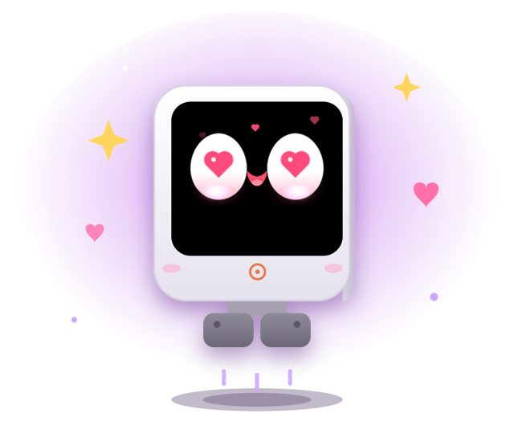
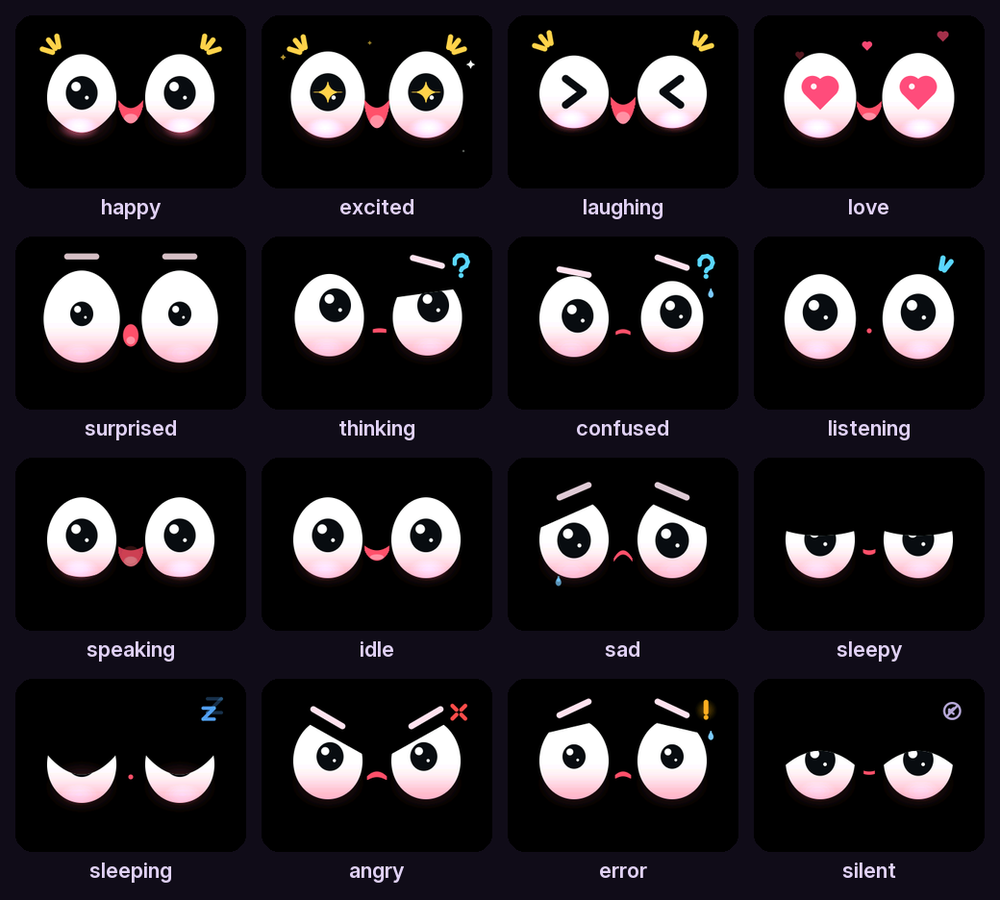
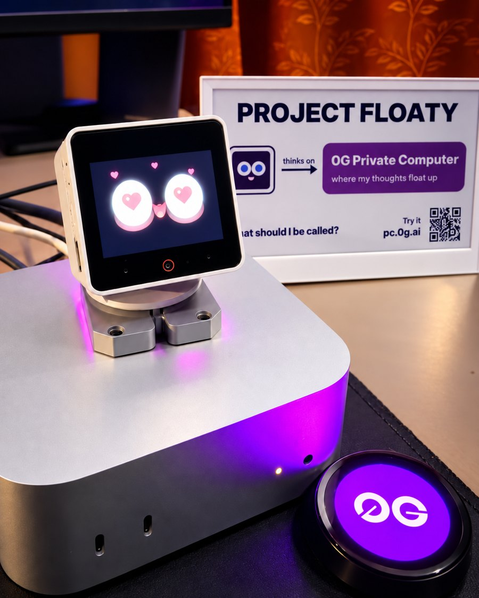

<div align="center">



# Project Floaty

**A palm-sized AI agent with a face.**<br>
It hears you, thinks on [0G PC](https://pc.0g.ai), and shows how it feels.

Built in public by the 0G DevRel team · "Floaty" is a codename until the community names it

[Play with its faces](https://0gfoundation.github.io/project-floaty/) · [Quick start](#quick-start) · [What's inside](#whats-inside) · [Ask Floaty](#ask-floaty-on-0g-pc) · [Roadmap](ROADMAP.md)

</div>

## Meet Floaty

Floaty sits on your desk and listens for its name. Ask it to look into something and it goes off, does the
research, and tells you what it found. It remembers what you tell it, runs your mornings on a schedule, and
answers questions about what its camera sees. Its brain runs on a computer at home, and the heavy thinking happens
on [0G PC](https://pc.0g.ai).

It also has 16 faces and 7 head moves, so you always know what it is up to. **[Play them in your browser](https://0gfoundation.github.io/project-floaty/)**, with the real head moves:

<p align="center"></p>

The code opens one piece at a time. **This repo is the first piece: Floaty's live dashboard.** The brain and the
firmware will be open sourced soon; see the [roadmap](ROADMAP.md).

## Quick start

No robot needed: a simulated bot streams sensors, events and sound.

```bash
git clone https://github.com/0gfoundation/project-floaty && cd project-floaty
uv run python -m dashboard.server        # the dashboard, on http://localhost:8175
uv run python tools/fake_robot.py        # in a second terminal: the simulated bot
```

Open **http://localhost:8175**. Without `uv`: `pip install aiohttp`, then the same commands with `python`.

## What's inside

| Tab | What you see |
| --- | --- |
| **Dashboard** | The robot's link, usage today, models, anything waiting for a yes, recent errors |
| **Memory** | What Floaty remembers: facts, documents, past conversations, search, and **Ask Floaty** |
| **Sensors** | Everything it senses, live: what it hears (spectrogram, waveform, transcripts), motion, proximity, touch, head position, power |

More tabs switch on one at a time (Faces, Tools, Routines, Notifications and others). Dashboard and Memory run on
made-up demo data, labelled **DEMO DATA** on the page.

<details>
<summary><b>Screenshots</b></summary>

<br>

**Dashboard**


**Memory**


**Sensors**


</details>

## Ask Floaty, on 0G PC

The Memory tab has an **Ask Floaty** button. It finds the memories that match your question, and a model on
[0G PC](https://pc.0g.ai) answers from them in Floaty's voice, in about 2 seconds.

It runs 0G's own `0gm-1.0-35b-a3b` in **private mode**: the model runs inside an Intel TDX enclave, so neither 0G
nor the machine's host can see your question. If no enclave is free, it waits rather than falling back.

```bash
cp .env.example .env     # then put your 0G PC key in ZG_API_KEY (card or crypto, at pc.0g.ai)
```

Everything else works without a key; Ask just tells you how to switch it on.

## Repo map

```
dashboard/          the server and the page
  admin.html        the dashboard page, one tab per part of the robot
  hub.py            the live sensor hub the robot streams to
  memory.py         the memory store and Ask Floaty
  zg.py             the 0G PC client
data/               demo data for the Dashboard and Memory tabs
tools/fake_robot.py the simulated bot
PROTOCOL.md         how the robot streams sensors and sound
ROADMAP.md          what opens next
tools/build_site.py builds the faces site (GitHub Pages)
docs/DEVELOPING.md  adding a tab, connecting a real robot, design notes, tests
```

## In real life

<p align="center"></p>

## Credits and license

MIT · Built by the 0G DevRel team · Hardware: M5Stack StackChan · Full credits in [CREDITS.md](CREDITS.md)
