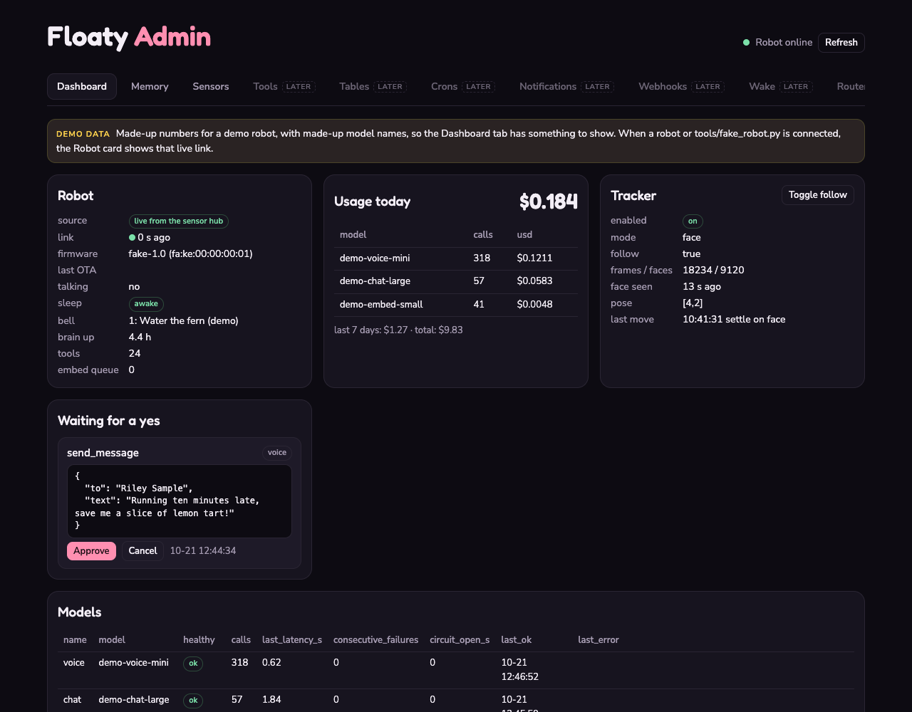
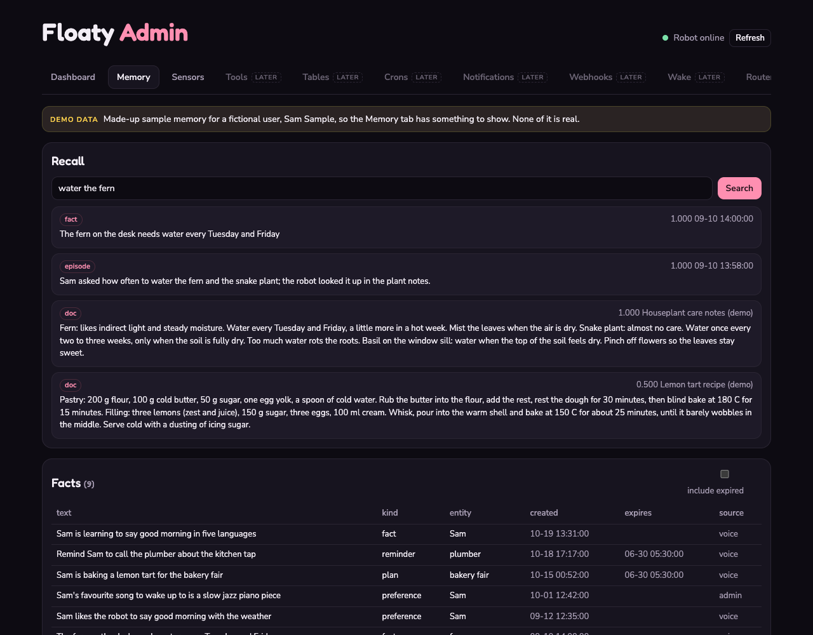
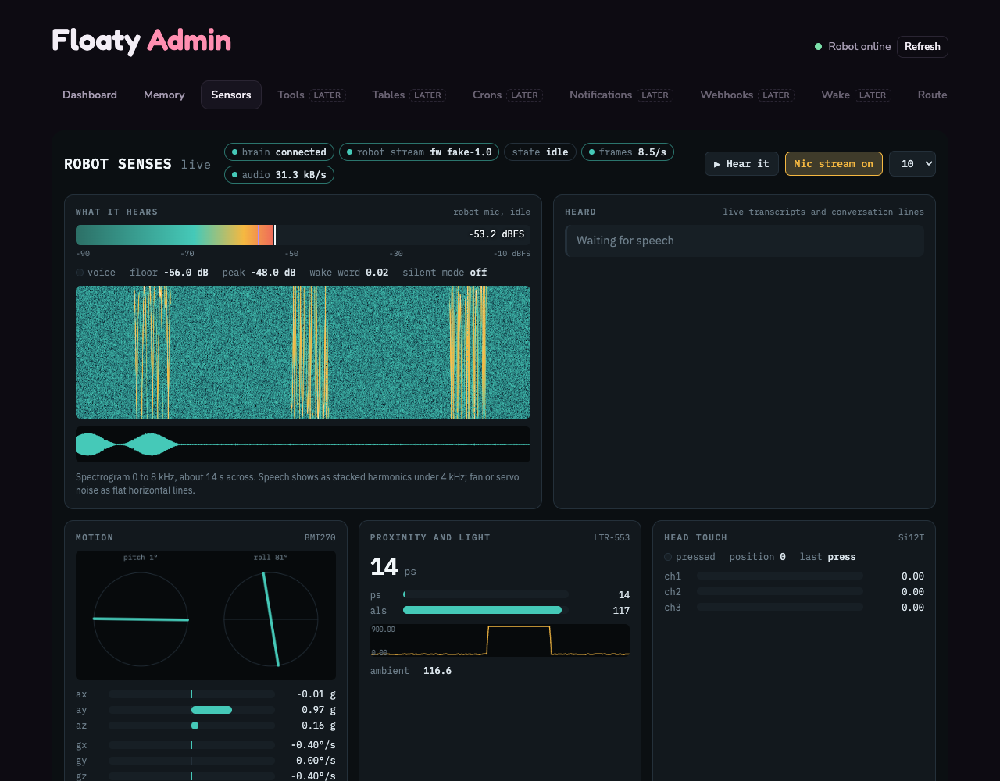

# Project Floaty: a live dashboard for a desk bot

The Floaty admin page: one browser page with a tab per part of the robot. Today it shows a dashboard of the
robot and its brain, what the robot remembers, and everything it senses, live. More tabs switch on one at a time.

Project Floaty is a palm-sized AI agent with a face, built in public by the 0G DevRel team. It wakes when you
call it, hands long jobs such as research to a background agent, asks before it acts, remembers what you tell it
and runs routines on a schedule. Its brain runs on a computer at home; the cloud thinking goes through one
OpenAI-compatible API on [0G Private Computer](https://pc.0g.ai). "Floaty" is a working codename; the community
picks the real name.

The code opens one piece at a time: this repo starts with the dashboard and the protocol it speaks. What comes
next is in [ROADMAP.md](ROADMAP.md).

## Tabs

| Tab | What it shows | Data today |
| --- | --- | --- |
| **Dashboard** | Robot link, usage today, face tracker, tool calls waiting for a yes, models, recent errors | Demo data (`data/demo_dashboard.json`); the Robot card goes live while a robot streams to the hub |
| **Memory** | Facts, documents and past conversations, with search (read only) | Demo data (`data/demo_memory.json`) |
| **Sensors** | Live mic level, spectrogram, waveform and transcripts; motion, proximity and light, touch, servos, power, events | A robot, or `tools/fake_robot.py` |
| Tools, Tables, Crons, Notifications, Webhooks, Wake, Router | Shown as disabled "later" chips; the page code is already in `dashboard/admin.html` | Not served yet |

Demo data is made up (a fictional user and made-up model names) and both tabs that use it say **DEMO DATA** in a
banner. A Faces tab (every expression and gesture, previewed on a drawn head) is built but switched off and kept
out of the tab bar; `--tabs dashboard,memory,sensors,faces` turns it on.

### Dashboard



Same cards and response shapes as the robot brain's admin overview (`GET /admin/overview`, `GET /usage`), served
from `data/demo_dashboard.json` by [`dashboard/admin.py`](dashboard/admin.py). Times in the file are "seconds ago",
so the demo always looks current. Approve, Cancel and Toggle follow work on the demo state and run nothing. The
hub keeps a robot connected only while someone has the Sensors tab open (and for 30 s after), so the Robot card
shows the live link then, and the demo robot otherwise.

### Memory



The routes and JSON shapes match the brain's memory API (`/memory/facts`, `/memory/docs`, `/memory/episodes`,
`/memory/episodes/{id}`, `/memory/brief`, `POST /memory/recall`), served by
[`dashboard/memory.py`](dashboard/memory.py) from a JSON file. Search here is keyword only; the brain adds
embeddings, with the same result shape. Point it at your own file with `--memory path/to/file.json`.

### Sensors



The live sensor page, also on its own at `/sensors`. It sits in a frame that exists only while the tab is open, so
leaving the tab lets the robot stop streaming.

## Ask Floaty, on 0G Private Computer

The Memory tab has an **Ask Floaty** button: it finds the memories that match your question and has a model on
[0G Private Computer](https://pc.0g.ai) answer from them, in Floaty's voice. By default it runs 0G's own `0gm-1.0-35b-a3b` (about 2 seconds per answer) in
**private** mode: the model runs inside an Intel TDX enclave, so neither 0G nor the GPU host sees the prompt, and
if no enclave is free the router fails closed instead of falling back to a lower tier.

```bash
cp .env.example .env      # .env is git-ignored
# put your key in ZG_API_KEY (from pc.0g.ai, card or crypto top-up), then start the server as below
```

It is one OpenAI-compatible call ([`dashboard/zg.py`](dashboard/zg.py)): `POST {ZG_BASE_URL}/chat/completions`
with the header `X-0G-Provider-Trust-Mode: private`. `ZG_MODEL` and `ZG_TRUST_MODE` change the model and tier.
Without a key everything else works and Ask says how to switch it on.

## Try it in one minute (no robot needed)

```bash
git clone https://github.com/0gfoundation/project-floaty && cd project-floaty
uv run python -m dashboard.server          # or: pip install aiohttp, then python -m dashboard.server
# in a second terminal, for the Sensors tab
uv run python tools/fake_robot.py
```

Open http://localhost:8175/ (also /admin). `/#memory` opens a tab directly. The fake robot streams sensor frames,
a few events and synthetic audio (room noise with a burst of tone every 5 seconds). Press **Hear it** to listen.

Pick which tabs are on with `--tabs` (ids or labels; `all` for every tab with a backend):

```bash
uv run python -m dashboard.server --tabs dashboard,sensors
uv run python -m dashboard.server --tabs all
```

## Adding a tab

The tab bar comes from one list, `TABS` in [`dashboard/config.py`](dashboard/config.py), and the ids switched on
by default, `ENABLED`. The page reads it from `GET /api/tabs`. A tab is live when it is switched on and the server
has its backend; otherwise it is a disabled "later" chip (or left out of the bar when `listed=False`). Every admin
tab's markup and script already sit in `dashboard/admin.html`. To ship one:

1. Write its backend: a module with a `routes(app)` that serves the routes its loader in `admin.html` calls,
   from demo data in `data/` (labelled DEMO DATA in the page) or a real source.
2. In `make_app` in [`dashboard/server.py`](dashboard/server.py), call those routes when the tab is enabled and
   add its id to `available`.
3. Add the id to `ENABLED` (or start the server with `--tabs`), add a test in `tests/`, and a screenshot here.

## With a real robot

The robot opens a websocket to `/robot/telemetry` while someone has the Sensors tab open. `GET /link` tells it
whether anyone is watching. Everything the robot sends is in [PROTOCOL.md](PROTOCOL.md): sensor frames at
1 to 20 Hz, events, and raw 16 kHz mic audio.

The firmware side (a small telemetry module for the robot's ESP32-S3 board: BMI270, LTR-553, Si12T, FT6336,
AXP2101, mic hooks) will be published with the firmware fork. Until then, any firmware that speaks the protocol
works.

## Design notes

- **Streams only while watched.** The robot streams while the Sensors tab is open and for 30 s after; nothing is
  stored.
- **Audio never blocks the robot.** On the robot, audio hooks only copy into a ring buffer; one low-priority
  task does the network work and counts drops.
- **Live transcripts are pluggable.** Pass any `async transcribe(pcm) -> {"text": ...}` object as
  `SensorHub(stt=...)` to get a partial transcript every second and a final one after 0.7 s of quiet.
- **Read only, demo first.** Memory and the Dashboard serve fictional demo data in the brain's shapes, so the
  page can later point at a real brain unchanged.

## Tests

```bash
uv run --extra test python -m pytest
```

## Credits and license

MIT. Built by the 0G DevRel team.

Hardware: M5Stack StackChan. See [CREDITS.md](CREDITS.md).
