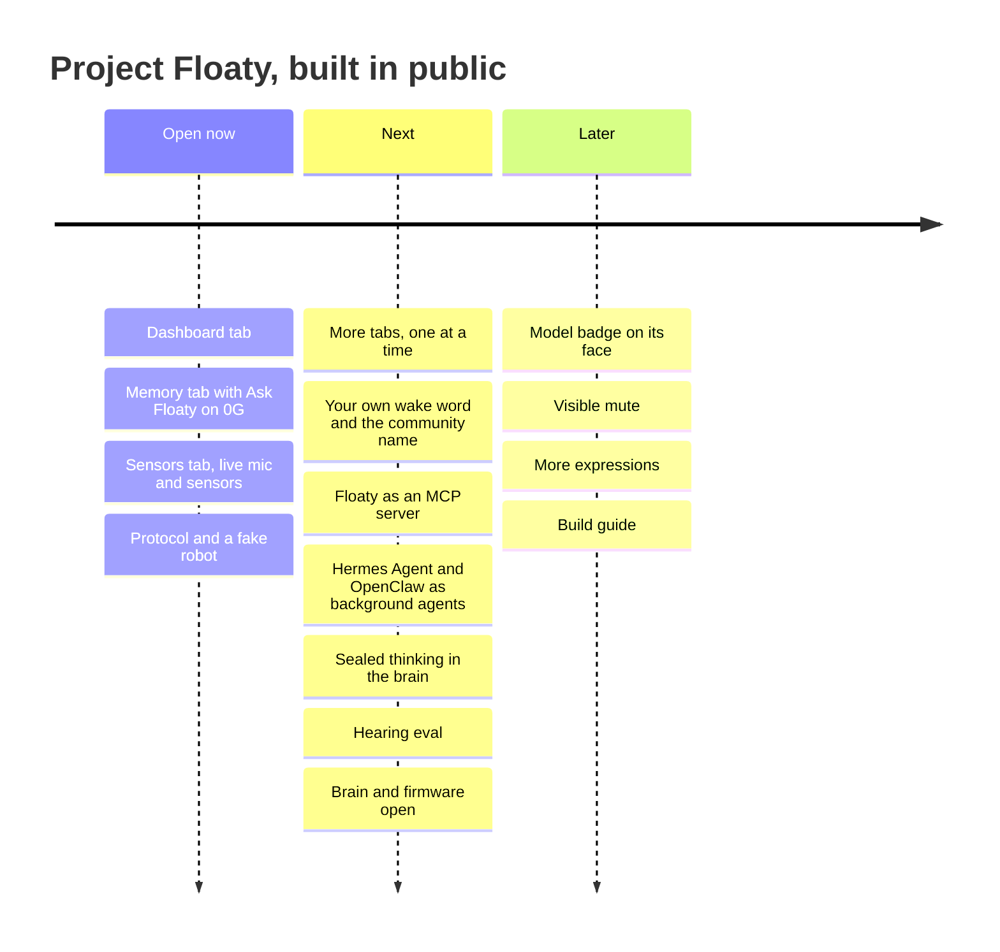
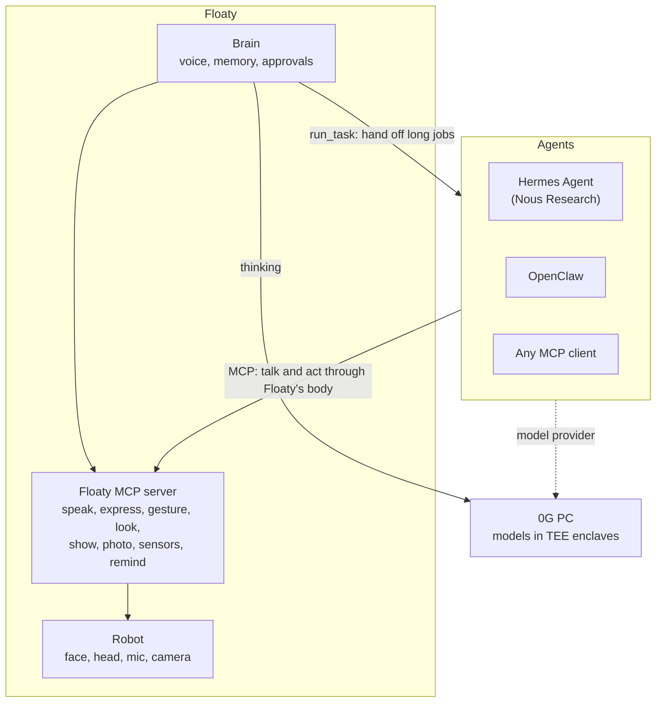

# Project Floaty roadmap

Floaty (a working codename) is a palm-sized AI agent with a face, built in public by the 0G DevRel team on
M5Stack StackChan hardware. Its brain runs on a computer at home; the cloud thinking runs on 0G PC, and live voice uses OpenAI realtime.

The code opens one piece at a time.

## Open now

- [x] Dashboard tab: robot link, usage, approvals waiting, models, errors (demo data)
- [x] Memory tab: facts, documents and past conversations, with search (demo data)
- [x] Ask Floaty on the Memory tab: answers from memory on 0G PC, private mode (Intel TDX enclave)
- [x] Sensors tab: live mic, spectrogram, transcripts, motion, proximity, touch, servos, power, events
- [x] Telemetry protocol (PROTOCOL.md) and a fake robot, so it all runs without hardware

## Next

- [ ] More dashboard tabs, one at a time: Faces, Tools, Crons (routines), Notifications, Webhooks, Wake, Router, Tables
- [ ] Wake word as a setting: every builder picks their own, and the community picks Floaty's real name
- [ ] Tools and agents (below): Floaty as an MCP server, and Hermes Agent and OpenClaw as its background agents
- [ ] Sealed thinking in the brain: background and routine jobs in 0G PC's private mode, with every
      reply's signature checked at home
- [ ] Hearing eval: the clip sets and scoring script behind the speech gate and the second wake listener
- [ ] The brain: the agent service (voice, tools, memory, routines, background tasks, approvals)
- [ ] The firmware: the StackChan fork with the telemetry module, the always-on listener and the faces,
      keeping every upstream license

## Tools and agents

Floaty already calls tools in conversation: face and head (`express`, `gesture`, `look`), the screen
(`show_message`), the camera (`take_photo`), reminders, memory, and `run_task`, which hands long jobs to a
background agent and asks for a yes before anything acts. The plan opens that up both ways over MCP:

- [ ] **Floaty MCP server:** the robot's body and senses as MCP tools (speak, express, gesture, look,
      show_message, take_photo, read sensors, set reminders), so Hermes Agent, OpenClaw or any MCP client can give
      itself a face, a voice and a head that turns toward you.
- [ ] **Hermes Agent as a background agent:** `run_task` hands research and multi-step jobs to Hermes Agent over
      MCP; progress and results come back as Floaty's voice, and anything that acts still waits for your yes.
- [ ] **OpenClaw as a background agent:** the same path through OpenClaw's MCP server mode, so its skills
      (messaging, browsing, files) become things you can ask Floaty for out loud.
- [ ] **One model provider:** each agent can use 0G PC as its model provider, so the
      whole stack can run on the same key and the same private mode.
- [ ] **Approvals stay on the robot:** a tool call from any agent that sends, buys or deletes shows on Floaty's face
      and waits for a spoken yes.

## Later

- [ ] A badge on its face showing which model answered
- [ ] A visible mute that stops all listening
- [ ] More expressions and head moves
- [ ] A build guide: parts list and setup from zero
